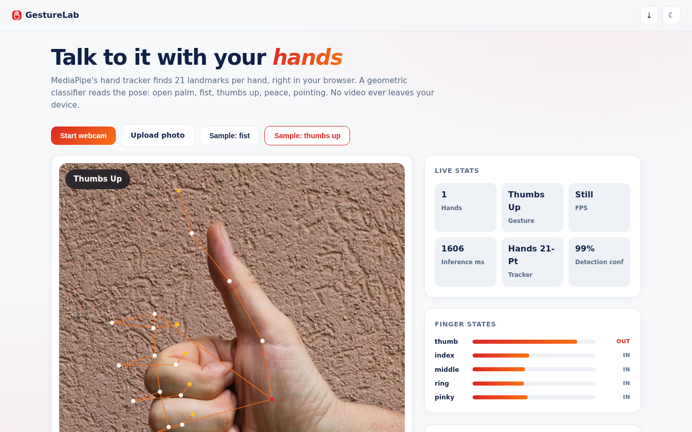
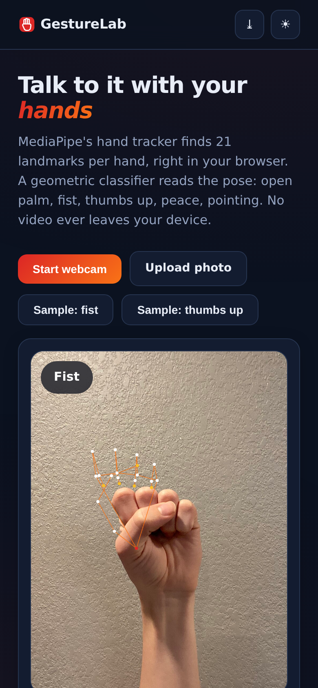

# GestureLab - Hand Gesture Recognition

**Talk to it with your hands.** MediaPipe's 21-point hand tracker plus a geometric pose classifier recognize open palm, fist, thumbs up, peace and pointing - in real time on webcam or from photos, entirely in your browser. No video frame ever leaves your device.

**Live demo:** https://akash991833.github.io/hand-gesture-recognition/

## Features

- **Real hand tracking, fully local** - MediaPipe Hands solution (vendored WASM + TFLite models, ~24MB), 21 landmarks per hand, up to 2 hands
- **Live skeleton overlay** - joints and bones drawn over the feed, fingertip highlighting
- **Geometric gesture classifier** - reads finger-extension geometry: open palm, fist, thumbs up, peace, pointing, with live finger-state bars (thumb/index/middle/ring/pinky out vs in)
- **Smart still handling** - photos are padded with margin before detection (the palm detector needs border around the hand; fixed and verified)
- **Gesture log** - live sessions log each recognized gesture change with timestamps
- **Webcam + uploads + samples** - bundled fist and thumbs-up photos, both verified
- **PWA** - installable; models cache for offline use after first load
- **Premium UI** - white professional design, navy ink, red-orange accent, dark + light, responsive

## Screenshots

## Honest limits

Gestures are read from landmark geometry, not a trained gesture model - best with one clear, upright hand facing the camera at arm's length. Rotated hands, gloves, low light and cropped fingers confuse it; night photos and very small hands can be missed entirely. Stated in-app. All processing is local.

## Tech

Vanilla HTML/CSS/JS + MediaPipe Hands 0.4 (vendored). Sample photos: Wikimedia Commons.

## Run locally

Serve the folder (`python3 -m http.server`) and open `http://localhost:8000` (camera needs localhost or HTTPS).
